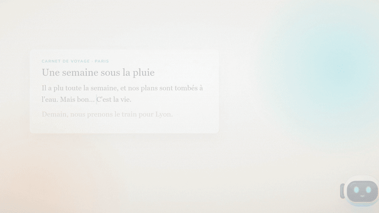

<div align="center">

# Screen Buddy

**Select any text on Windows. A little robot explains it in simple English and Urdu, right where you read.**

Runs 100% on your PC with a local model through [Ollama](https://ollama.com). No cloud, no account, no telemetry.




<!-- Full intro video: edit this README on github.com and drag the video file onto this line.
     GitHub uploads it and inserts a link that plays right here in the README. -->

</div>

---

## Contents

- [Why Screen Buddy](#why-screen-buddy)
- [Features](#features)
- [Privacy](#privacy)
- [User guide](#user-guide)
  - [Requirements](#requirements) · [Install](#install) · [Using it](#using-it) · [The robot](#the-robot)
  - [Tray, taskbar and menu](#tray-taskbar-and-menu) · [Settings](#settings) · [Troubleshooting](#troubleshooting) · [Uninstall](#uninstall)
- [Developer guide](#developer-guide)
  - [Prerequisites](#prerequisites) · [Run it](#run-it) · [Checks](#checks) · [Project structure](#project-structure)
  - [How it works](#how-it-works) · [Rules the code keeps](#rules-the-code-keeps) · [The prompt](#the-prompt) · [Build the installer](#build-the-installer)
- [Tech stack](#tech-stack)

---

## Why Screen Buddy

You are reading an article, a PDF or a chat, and one word or line stops you. Normally you would copy it, open a
translator, paste, read, and come back. Screen Buddy removes all of that: **select the text and keep reading.**
A small floating robot flies next to it and a card shows the meaning in simple English and the Urdu
translation, streamed as it is written.

## Features

| | |
|---|---|
| **Select and read on** | Select with a drag or a double-click in any app: browsers, PDFs, Word, chats, editors, terminals. The answer card appears next to the selection and never takes focus, so your selection stays. |
| **Simple English + Urdu** | A word or idiom gets its meaning, the Urdu, its type and an example. A sentence gets a simpler version and its Urdu translation, with a note for idioms or slang. Urdu is shown right-to-left in a Nastaliq font. |
| **More than English** | Roman Urdu (`kal milte hain`), Urdu script, and French, Spanish and Portuguese work well. |
| **A robot with a face** | An original floating robot head whose LED face shows what it is doing: it notices, thinks, talks, winks, sleeps when paused, and shows a clear sign when something is wrong. |
| **Private by design** | The text goes only to Ollama on your own PC (`http://127.0.0.1:11434`). Password fields and apps you block are never read. |
| **Works where others can't** | When an app can't share its selection (some terminals, Edge's PDF viewer), Screen Buddy copies it and then puts your clipboard back exactly as it was. |
| **Light on your PC** | After a quiet moment the robot rests and its animations stop, so it uses very little CPU while you read. |

## Privacy

- Selected text is sent **only** to the local Ollama server at `http://127.0.0.1:11434`. Nothing else goes
  anywhere: there is no backend, no account and no telemetry.
- Password fields are never read, and you can block any app (password managers are blocked by default).
- The clipboard fallback restores your previous clipboard, never runs when Windows clipboard sync is on,
  and never logs what it copied.
- Answers are kept in memory only (for repeats in the same session), never saved to disk.
- The log file records events and problems, never the selected text (in release builds).

---

## User guide

### Requirements

- Windows 11 (64-bit)
- [Ollama](https://ollama.com/download) installed and running
- The model, downloaded once:

  ```powershell
  ollama pull qwen3.5:4b
  ```

  Any other Ollama model can be chosen in Settings.

### Install

Prebuilt installers aren't published yet, so build the installer once (see
[Build the installer](#build-the-installer)), then:

1. Run `Screen Buddy_<version>_x64-setup.exe`. It installs for your user only, without admin rights, to
   `%LOCALAPPDATA%\Screen Buddy`, with a Start-menu shortcut.
2. The app isn't code-signed yet, so Windows may show a "Windows protected your PC" warning: choose
   **More info → Run anyway**.
3. Start **Screen Buddy** from the Start menu. The robot appears in the middle of the screen as a hologram,
   flies to a corner and greets you.

### Using it

1. **Select text** in any app: drag over it (at least a few pixels) or double-click a word.
2. The robot flies next to the selection and the **answer card** appears and fills in.
3. Keep reading. A click anywhere else closes the card, and the robot flies back.

On the card:

| Button | What it does |
|---|---|
| Copy | Copies the answer. |
| ✕ | Closes the card. |
| Retry | Shown when something went wrong; asks again. |
| *Wrong text? Use the clipboard in …* | If an app gave the wrong words, read this app's selections through the clipboard from now on. |

Tips:

- Any selection of 2 characters or more is explained; very long ones are cut to 2,000 characters.
  Selecting the same text again while its card is open does nothing.
- The first answer after starting Ollama can take a few seconds while the model loads; then answers arrive in
  about one or two seconds.

### The robot

| Looks like | Means |
|---|---|
| Round blinking eyes, floating | Ready. |
| Wide eyes, then `!` | Your selection was noticed. |
| Pulsing dots or a spinning ring | The model is thinking. |
| `^ ^` eyes and a moving mouth | The answer is being written. |
| Red `404` | Nothing could be read there. |
| Red `X` | The app is on your block list. |
| A lock and blushing pixels | A password field: not read. |
| Amber `!` | A problem; the card says what to do. |
| Red plug | Ollama isn't running, or the model is missing. |
| Sleepy eyes and `z z` | Paused. |

Drag the robot anywhere you like (it stays there until the next start). It also winks, yawns, looks around
or turns around now and then when idle.

### Tray, taskbar and menu

- **Taskbar button:** opens Settings. Closing Settings puts it back on the taskbar; the app keeps running.
- **Tray icon** (next to the clock) and **right-click on the robot**: *Settings*, *Pause / Resume*, *Quit*.
- **Quit** closes the app (the robot vanishes in a beam of light).

### Settings

| Section | Setting | What it does |
|---|---|---|
| General | Paused | Selections are ignored until you resume. |
| | Fly to the selection | The robot flies next to each answer and back. |
| | Your name | Used in the startup greeting (your Windows first name by default). |
| | Greet me at startup | A short greeting, written fresh by the model. |
| | Idle play | The robot winks, yawns or turns around now and then. |
| | Reset mascot position | Brings the robot back to the bottom-right corner. |
| Model | Model name, **Check** | Which Ollama model answers; **Check** tests that it is installed. |
| Privacy | Blocked apps | Apps whose text is never read. *Restore defaults* brings back the built-in list. |
| Clipboard fallback | Use the clipboard when needed | Lets Screen Buddy copy a selection the app can't share, and put your clipboard back. |
| | Always use the clipboard in these apps | For apps that report the wrong words. |

### Troubleshooting

| Problem | Fix |
|---|---|
| Nothing happens when I select text | The app may be **paused**: the robot has sleepy eyes. Right-click it → *Resume*. |
| Red plug / "Ollama is not running" | Start Ollama (from the Start menu), then select again. |
| "The model is not installed" | Run `ollama pull qwen3.5:4b`, or pick an installed model in Settings → Model → **Check**. |
| Red `404` or "nothing selected" | Some apps don't share their selection. Keep the clipboard fallback on, or add the app under *Always use the clipboard*. |
| The card shows the wrong words | Click *Wrong text? Use the clipboard in …* on the card. |
| Nothing in a terminal | Terminals are read through the clipboard with their own copy keys (never Ctrl+C); keep the clipboard fallback on. |
| The first answer is slow | The model is loading; the next answers are fast. |

The log file helps with anything else: `%LOCALAPPDATA%\com.screenbuddy.desktop\logs\screen-buddy.log`
(times are in UTC).

### Uninstall

Windows Settings → Apps → Installed apps → **Screen Buddy** → Uninstall. Your settings are in
`%APPDATA%\com.screenbuddy.desktop\` if you want to remove them too.

---

## Developer guide

### Prerequisites

- Windows 11 with [WebView2](https://developer.microsoft.com/microsoft-edge/webview2/) (built in)
- [Rust](https://rustup.rs) (stable, MSVC toolchain) and the Visual Studio C++ build tools
- [Node.js](https://nodejs.org) 20 or newer
- Ollama with the model (see [Requirements](#requirements))

### Run it

```powershell
npm install
npm run tauri dev
```

The app starts with hot reload for the frontend. Debug builds add two tray items: *Test Ollama* and
*Preview mascot states* (shows every look of the robot). Quit an installed copy first: both share the same
settings file and single-instance lock.

### Checks

Run after every change (in `src-tauri` for the Rust ones):

```powershell
cargo check
cargo clippy --all-targets -- -D warnings
cargo clippy --release --all-targets -- -D warnings
cargo test
npm run build
```

### Project structure

```
src-tauri/src/
  selection/     mouse_hook.rs  low-level mouse hook (mouse only, never a keyboard hook)
                 trigger.rs     drag / double-click rules
                 uia_reader.rs  reads the selection with UI Automation
                 clipboard.rs   the clipboard fallback (saves and restores the clipboard)
                 process_info.rs  which app, window frame detection
  privacy/       gate.rs        password fields, block list, own windows
  explainer/     prompt.rs      the system prompt and input cleaning
                 cache.rs       in-memory LRU cache of answers
  provider/      ollama.rs      streaming Ollama client behind the Provider trait
  windows/       mascot.rs, flight.rs, popup.rs, placement.rs, settings.rs
  flow.rs        selection -> popup + robot events; notice.rs: user-facing problem messages
  settings.rs    persisted settings and the Settings window's commands
  tray.rs        tray icon and the robot's menu
src/
  mascot/        the robot: Robot.tsx (SVG), face.ts (LED face shapes), turn.ts, mascot.css
  popup/         the answer card: Popup.tsx, answer.ts (parses the model's lines)
  settings/      the Settings window
  shared/        events, fonts, base styles
docs/media/      README images
spike/           the first Python prototype (reference only)
```

### How it works

```
mouse hook ─▶ trigger rules ─▶ UI Automation (or clipboard fallback) ─▶ privacy gate
   ─▶ explainer (cache, prompt) ─▶ Ollama on 127.0.0.1 (streaming)
   ─▶ events to the popup (card) and the mascot (robot)
```

Three windows: the **mascot** (transparent, always on top, never focused), the **popup** (the answer card,
never focused, so the selection survives) and **Settings** (also the taskbar button).

### Rules the code keeps

These are the project's hard rules; the full list is in [`CLAUDE.md`](CLAUDE.md).

- Read text with UI Automation first; **no screenshots, ever**. The clipboard is only a fallback, and it always
  restores the user's clipboard.
- **Mouse hook only**, never a keyboard hook.
- Selected text goes **only** to `http://127.0.0.1:11434`. No telemetry, no backend, no accounts.
- Skip password fields and blocked apps. The popup never takes focus.
- Model output is rendered as **plain text**, never HTML.
- No code from GPL projects.

### The prompt

The system prompt is in `src-tauri/src/explainer/prompt.rs`. A fixed set of 30 test selections is in
`src-tauri/tests/prompt_cases.txt`. To see the app's real answers for them from your local Ollama:

```powershell
cd src-tauri
cargo test prompt_eval -- --ignored --nocapture
```

Answers vary from run to run, so compare several runs before changing the prompt.

### Build the installer

```powershell
npm run tauri build
```

This produces `src-tauri\target\release\bundle\nsis\Screen Buddy_<version>_x64-setup.exe` (per-user install,
no admin rights). The app icon is made from `src-tauri/icons/source.svg`: render it to a 1024×1024
transparent `icon-source.png` and run `npx tauri icon src-tauri/icons/icon-source.png` (then delete the
`android` and `ios` folders it adds).

> **Smart App Control:** if Windows blocks a build step with *os error 4551*, run
> `cargo clean -p <the blocked crate>` (add `--release` for release builds) in `src-tauri` and build again.

Commit messages follow [Conventional Commits](https://www.conventionalcommits.org).

---

## Tech stack

- **App:** [Tauri 2](https://tauri.app) with a Rust core and a React 19 + TypeScript frontend (Vite)
- **Windows APIs:** the [`windows`](https://crates.io/crates/windows) crate: UI Automation, low-level mouse hook,
  clipboard, DWM
- **Model:** [Ollama](https://ollama.com), default `qwen3.5:4b`, streamed over its local HTTP API
- **Fonts:** Nunito and Noto Nastaliq Urdu (SIL Open Font License), bundled with the app

<div align="center">
<sub>Made for reading in English without leaving the page.</sub>
</div>
